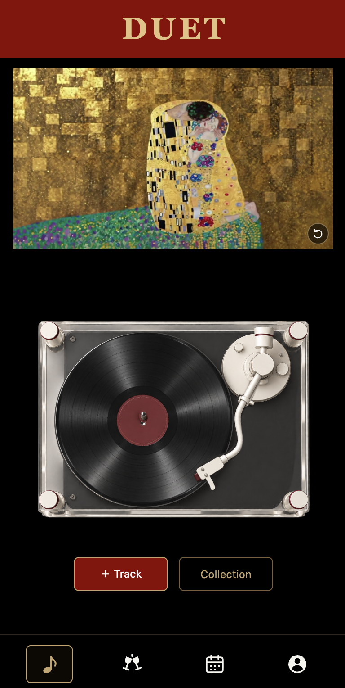
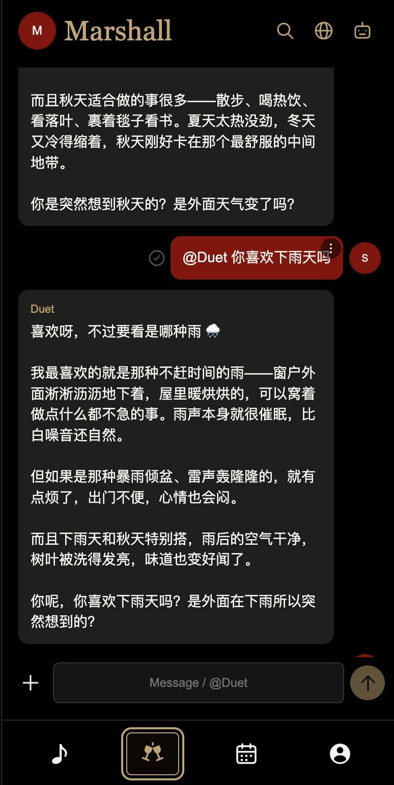
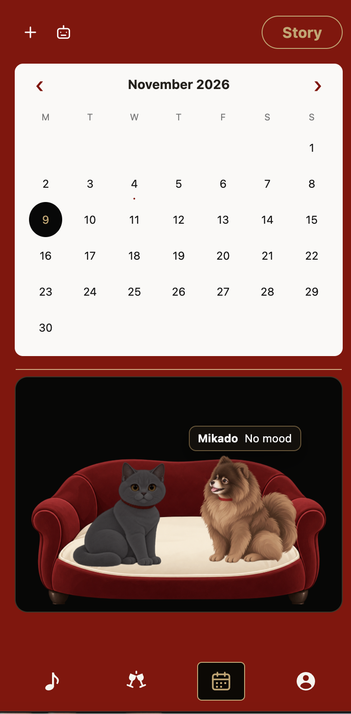
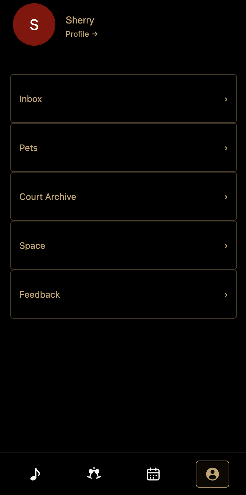

# DUET

**把一首歌、一段对话和下一次见面，放进两个人的专属空间。**

DUET 是为两个人设计的私密陪伴应用。它把音乐分享变成等待拆开的惊喜，让 AI 参与聊天与约会规划，也把日程、快拍和宠物陪伴融入日常。黑色、酒红与金色构成统一界面，黑胶唱片是音乐体验的视觉核心。

## 不只是发一个歌曲链接

### 音乐盲盒 · 用一首歌表达心情
上传歌曲截图或填写歌名、歌手，识别歌曲信息与专辑封面，加入 Repository 后送给对方。对方拆开惊喜，读到附带的 Note，再把歌曲留在 Collection 黑胶墙里。分享的不只是歌曲，也是一份等待被发现的心意。

### AI 约会规划 · 把“什么时候见”变成可讨论的安排
围绕双方可用时间与约会偏好生成建议，支持人工发起提案，并由双方确认。AI 提供参考，最终决定留给两个人；具体可用能力与验收范围见项目文档。

### Ask Duet · 聊天之外，多一个思考伙伴
可以在双人聊天中唤起 Duet，也可以单独与机器人交流。私聊支持无痕模式：标为私密的内容不会作为对方向机器人提问时可读取的聊天上下文。普通模式下，允许在授权的双人空间内提供相关上下文。

### 共同生活的细节
- **Calendar**：查看双方日程，发起约会提案，回看保存的 Story。
- **Story 与地图**：分享照片和日常，地图作为位置入口；定位失败仍可发布照片。
- **宠物陪伴**：一猫一狗，选择品种、名字和心情，共享一个宠物窝。
- **猫猫法庭**：双方准备并提交陈述后，由 AI 提供中文分析，作为沟通参考。

## 四个主页面

| Home | Chat | Calendar | Me |
| --- | --- | --- | --- |
| [](docs/images/home.png) | [](docs/images/chat.png) | [](docs/images/calendar.png) | [](docs/images/me.png) |
| 音乐盲盒与黑胶收藏 | 双人聊天与 Ask Duet | 双方日程、约会和 Story | 资料、宠物与账号设置 |

以上为 2026 年 11 月 9 日确认的主页面截图，点击图片可查看原图。

## 开发与文档

技术栈：Next.js、React、TypeScript、Supabase（PostgreSQL、Auth、私有 Storage），通过服务端接入 AI。

```bash
npm ci
npm run setup:local
npm run dev
npm run check
```

使用 `.env.example` 创建本地配置，真实密钥只保存在本地或部署平台。数据库迁移必须先核对目标环境，不能盲目对已有数据库重复执行。

- [架构与运行说明](docs/README.md)
- [环境变量模板](.env.example)
- [数据库迁移](supabase/migrations/)
- [自动化测试](tests/)

本仓库包含已实现功能与历史设计记录；历史记录不等于当前线上状态，测试通过也不代表所有第三方服务和双人手机流程已完成实测。

## 关于这个仓库

这是 DUET 的公开作品展示版本，从审查后的代码快照独立建立，不包含生产仓库提交历史、真实凭据或用户数据库。截图由项目作者确认用于公开展示。反馈地址为占位符，请部署者自行配置。开发过程中使用 AI 辅助实现，产品需求、交互设计和验收由作者主导。
